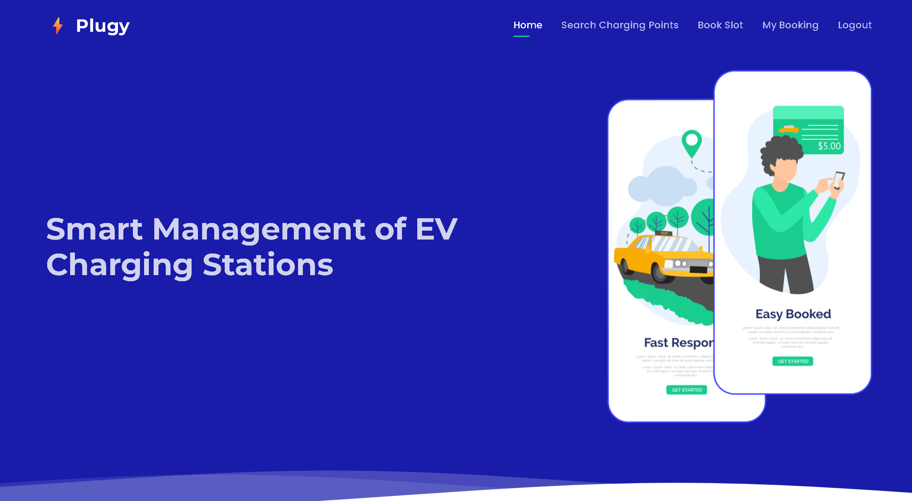

<div align="center">



  <br />

# ⚡ Plugy (SMEVCS)

**Smart Management of EV Charging Stations**


_A robust, scalable platform developed under Enthusiastic Collage Days to facilitate real-time electric vehicle (EV) charging slot discovery, dynamic pricing, advanced time-window reservations, and digital tax invoice generation._

</div>

<br />

## ✨ Key Features

- **📍 Real-Time Slot Discovery:** Filter available charging bays dynamically by geographic area, port compatibility, and charger types.
- **💰 Dynamic Pricing Engine:** Calculates base rates by factoring in vehicle type (**2-wheeler, 4-wheeler Normal AC, Fast DC**), duration, and specialized port discounts (e.g., 10% reduction for GB/T connectors), while seamlessly appending an **18% GST** calculation in real-time.
- **📅 Advanced Time-Window Reservations:** Book available slots immediately or schedule reservations in advance, visually organizing locations by city and area.
- **🧾 Digital Tax Invoices & History:** Generate print-ready receipts, securely view booking history, and manage current reservations without full-page reloads.
- **⚙️ Admin Dashboard:** Centralized infrastructure control to manage charging slots, monitor physical bays, and view comprehensive booking and payment histories.

---

## 🏗️ System Architecture & Tech Stack

Plugy operates on a monolithic **Model-View-Controller (MVC)** architecture, optimizing direct server-side rendering combined with dynamic client-side scripting for a highly responsive user experience.

### ⚙️ Backend Infrastructure

- **Application Layer:**  Pure Java MVC backend ensuring tight coupling with the Java ecosystem for rapid, secure page delivery.
- **Hosting:**  Hosted on Apache Tomcat (v9.0.74), providing a robust Java Servlet container for processing backend requests.
- **Data Persistence:**  Heavily normalized relational database utilizing standard JDBC (`com.connection.DBConnection`).
- **State Management:** User context is maintained globally via HTTP Session tracking, fortified by URL parameter fallbacks to prevent session-loss.

### 🎨 Frontend Engineering

The client-side interface relies heavily on modular JSP includes (`nav_user.jsp`, `footer_user.jsp`) to maintain structural DRY principles.

- **Presentation:**  Responsive grid layouts, interactive modals for secure DOM data injection, and modern navigation tabs.
- **Dynamic Engine:**  Powers the computational pricing engine in `Search.jsp` and manages cross-device compatibility.
- **Print & Media:** Clean, semantic markup with targeted `@media print` queries for rendering physical tax invoices.
- **Enhancements:** SVG hero waves, Animate On Scroll (AOS) library, and Remix Icons for intuitive visual hierarchy.

---

## 🗄️ Database Schema

The database relies on strict foreign key relationships and is built for horizontal scalability to separate transient transactional data from static infrastructure maps:

| 🗂️ Table      | 🎯 Core Function                                                            |
| :------------ | :-------------------------------------------------------------------------- |
| `tbl_admin`   | Manages backend administrator credentials and session logic.                |
| `tbl_user`    | Stores user metadata, encrypted passwords, and specific vehicle details.    |
| `tbl_station` | Defines physical infrastructure and macro-level localized addressing.       |
| `tbl_slot`    | Tracks individual bays, hardware port parameters, and real-time statuses.   |
| `tbl_payment` | The central transactional ledger capturing financial events and scheduling. |
| `tbl_booking` | Active slot reservations aggregated for localized user dashboard querying.  |
| `tbl_chat`    | Automated queries and answers driving the integrated smart chatbot.         |

---

## 🚀 Getting Started

### 📋 Prerequisites

Ensure you have the following environments installed on your local machine:

- 
- 
- 


### ⚙️ Workspace Setup & Deployment Guide

Follow the visual workflow below to import, provision, and deploy the application locally inside Eclipse IDE.

---

#### 📥 Phase 1: Import Application Source

Choose **Option A** to clone the version-controlled repository directly, or **Option B** to deploy from a packaged `.war` distribution.

##### 🔹 Option A: Clone via Git Repository (Recommended)
1. 📋 **Copy Repository URL:** Copy the HTTPS clone URL from the repository homepage.
2. 🗂️ **Open Smart Import:** In Eclipse, navigate to **File** ➔ **Import...**
3. 📦 **Select Git Provider:** Expand **Git** ➔ select **Projects from Git (with smart import)** ➔ click **Next**.
4. 🌐 **Select URI Source:** Choose **Clone URI** ➔ click **Next**.
5. 🔐 **Configure Authentication:** Eclipse will auto-populate the connection fields:
   * **URI:** Verify the cloned repository URL.
   * **User:** Your GitHub username.
   * **Password:** Enter a GitHub **Personal Access Token (PAT)** configured with `repo` scope permissions.
6. 🌿 **Select Branch:** Click **Next** ➔ select `main` branch ➔ define your local directory path.
7. 🚀 **Finish:** Click **Finish** to initialize and import the workspace project.

##### 🔹 Option B: Import from `.war` Distribution
1. 💾 **Download Assets:** Retrieve the `.war` package and `.sql` dump from the repository **Releases** tab.
2. 🗂️ **Open Import Wizard:** In Eclipse, navigate to **File** ➔ **Import...**
3. 📦 **Select Archive Type:** Expand **Web** ➔ select **WAR file** ➔ click **Next**.
4. 📂 **Select Target Archive:** Click **Browse...** to specify your downloaded `.war` file.
5. 🏷️ **Name Project:** Verify or enter the **Web project** name (`SMEVCS`).
6. ⚠️ **Skip EAR Option:** Leave **Add project to an EAR** unchecked ➔ click **Finish**.

---

#### 🗄️ Phase 2: Database Initialization & Connection

1. 🟢 **Start MySQL Service:** Launch **MySQL** via XAMPP Control Panel or your native system service.
2. 🌐 **Open Database Client:** Navigate to **phpMyAdmin** (`http://localhost/phpmyadmin`) or open the MySQL CLI terminal.
3. 📜 **Execute Database Schema:** Import or execute the provided SQL dump (`smevcs.sql`):
   ```sql
   CREATE DATABASE IF NOT EXISTS smevcs;
   USE smevcs;
   1. 🔧 **Configure Connection Class:**
   * In **Project Explorer**, navigate to `src` ➔ `com.connection` ➔ `DBConnection.java`.
   * Verify your local credentials match:
     ```java
     public static String DBName = "smevcs";
     public static String DBUSER = "root";
     public static String DBPASSWORD = ""; // Default empty string for standard local XAMPP setups
     ```

2. 📦 **Verify JDBC Driver:** Confirm that the MySQL connector (`mysql-connector-*.jar`) exists inside `WebContent/WEB-INF/lib/` (or `src/main/webapp/WEB-INF/lib/`).

---

#### 🖥️ Phase 3: Servlet Container (Apache Tomcat) Configuration

1. 🧭 **Open Servers Panel:** Navigate to **Window** ➔ **Show View** ➔ **Servers** (or **Window** ➔ **Show View** ➔ **Other...** ➔ **Server** ➔ **Servers**).
2. ➕ **Create Server Runtime:** Click the link: *No servers are available. Click this link to create a new server...*
3. 🏷️ **Select Server Version:** Expand **Apache** ➔ choose **Tomcat v9.0 Server** ➔ click **Next**.
4. 📁 **Specify Server Home:** Click **Browse...** to select your local Tomcat installation directory ➔ select your installed JDK/JRE runtime ➔ click **Finish**.
5. 🔗 **Bind Project Runtime Facet:**
   * Right-click the project root in **Project Explorer** ➔ **Properties**.
   * Select **Targeted Runtimes** from the left navigation panel.
   * Check **Apache Tomcat v9.0** ➔ click **Apply and Close**.

---

#### 🚀 Phase 4: Artifact Deployment & Execution


[](https://gitdiagram.com/ro-hitmane/smevcs?utm_source=readme&utm_medium=badge)

1. 🔄 **Deploy Project:** In the **Servers** panel, right-click **Tomcat v9.0** ➔ select **Add and Remove...**
2. ➡️ **Add to Configured List:** Select `SMEVCS` under **Available** ➔ click **Add >** to move it to **Configured** ➔ click **Finish**.
3. ▶️ **Launch Server:** Right-click the server node ➔ select **Start** (or launch via Debug mode).
4. 🔍 **Verify Console Logs:** Monitor the Eclipse **Console** tab to ensure the server starts on port `8080` without database or servlet mapping exceptions.
5. 🌐 **Launch Web App:** Open your preferred browser and navigate to:
   ``http://localhost:8080/SMEVCS/``
